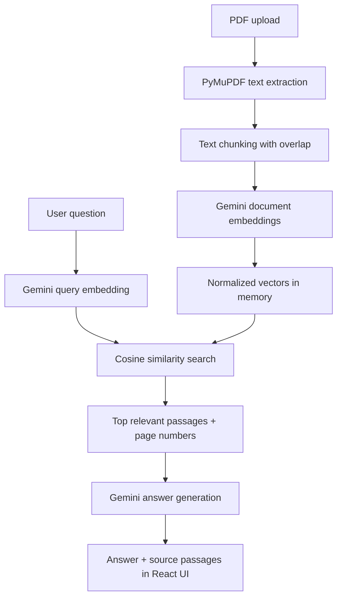

# Context AI — RAG PDF Chatbot

A portfolio-ready full-stack Retrieval-Augmented Generation (RAG) app that lets users upload a PDF, ask questions in natural language, and receive answers grounded in retrieved document passages with page-level source references.

## Highlights

- **PDF ingestion:** Upload a PDF up to 20 MB and 100 pages.
- **Semantic retrieval:** Gemini embeddings + cosine similarity (scikit-learn).
- **Grounded answers:** Gemini generates answers from retrieved excerpts and is instructed not to invent facts or page references.
- **Source transparency:** Expand the cited passages, inspect page numbers, and view similarity scores.
- **Chat experience:** Recent conversations are stored in browser local storage; answers can be copied.
- **Responsive interface:** Dark, violet/blue visual system, drag-and-drop upload, loading animation, elapsed timer, and mobile layout.
- **Debuggable API:** FastAPI health endpoint, request timing logs, and bounded provider request timeout.

## Tech stack

| Layer | Technologies |
|---|---|
| Frontend | React, Vite, JavaScript, CSS, Lucide React |
| Backend | Python, FastAPI, Uvicorn, Pydantic |
| PDF processing | PyMuPDF |
| Embeddings and LLM | Google Gemini API (`google-genai`) |
| Vector search | NumPy, scikit-learn cosine similarity |
| Configuration | `python-dotenv`, environment variables |

## Architecture



## Run locally on Windows

### 1. Requirements

- Python 3.10 or newer
- Node.js LTS and npm
- A Gemini API key from [Google AI Studio](https://aistudio.google.com/apikey)

### 2. Set up the backend

Open Command Prompt in the project directory:

```cmd
cd /d C:\Users\surendra\rag-pdf-chatbot-pro\backend
py -m venv .venv
.venv\Scripts\activate
copy .env.example .env
notepad .env
```

Put your own API key in `.env`. Keep the key private:

```env
GEMINI_API_KEY=your_real_api_key
GEMINI_CHAT_MODEL=gemini-3.8-flash
GEMINI_EMBED_MODEL=gemini-embedding-001
```

Install packages and run the API:

```cmd
python -m pip install --upgrade pip
pip install -r requirements.txt
uvicorn main:app --reload
```

API health check: <http://127.0.0.1:8000/api/health>  
Interactive API docs: <http://127.0.0.1:8000/docs>

The backend logs show when question embedding, retrieval, and answer generation begin and finish.

### 3. Set up the frontend

Open a **second** Command Prompt:

```cmd
cd /d C:\Users\surendra\rag-pdf-chatbot-pro\frontend
npm install
npm run dev
```

Open the URL printed by Vite, usually <http://localhost:5173/>.

### 4. Quick test

1. Upload a text-based PDF.
2. Ask a question whose answer is in the PDF.
3. Expand the cited passages and verify the page references.
4. Ask an unrelated question and confirm the assistant says when the document does not provide enough information.

## Repository structure

```text
rag-pdf-chatbot-pro/
├── backend/
│   ├── main.py
│   ├── requirements.txt
│   ├── .env.example
│   └── .gitignore
├── frontend/
│   ├── index.html
│   ├── package.json
│   └── src/
│       ├── main.jsx
│       └── styles.css
├── README.md
└── LINKEDIN_POST.md
```

## Performance notes

- Document embedding is performed in batches; query retrieval uses normalized vectors and cosine similarity.
- Answer generation uses a bounded output budget and low thinking effort to reduce unnecessary latency. Actual latency still depends on network quality, model load, API quotas, and PDF size.
- API calls have a 60-second HTTP timeout. The frontend shows elapsed time and stops waiting after 90 seconds.
- For a larger corpus, replace in-memory vectors with a persistent vector database and move long-running ingestion into a background task.

## Limitations and production checklist

This is a local portfolio project, not a production-secure document service.

- Uploaded PDFs and their vectors are held in backend memory and disappear when the backend restarts.
- Conversation history is stored in the browser's local storage. It is not synced across browsers/devices.
- Scanned PDFs need OCR; OCR is not included.
- The Gemini API receives text excerpts for embedding and answer generation.
- Add authentication, per-user document isolation, persistent storage, upload rate limits, monitoring, and deployment secrets management before public deployment.
- Similarity scores are retrieval scores, **not** probabilities that an answer is correct.
- Verify important answers against the source PDF.

## GitHub publishing checklist

1. Create a new GitHub repository, for example `context-ai-rag-pdf-chatbot`.
2. Copy the project files into the repository.
3. Ensure `.env` is not committed. Only `.env.example` should be tracked.
4. Add a screenshot or short demo GIF to the README.
5. Commit and push:

```cmd
git init
git add .
git commit -m "Build Context AI RAG PDF chatbot"
git branch -M main
git remote add origin https://github.com/YOUR_USERNAME/context-ai-rag-pdf-chatbot.git
git push -u origin main
```

Replace `YOUR_USERNAME` with your GitHub username.

